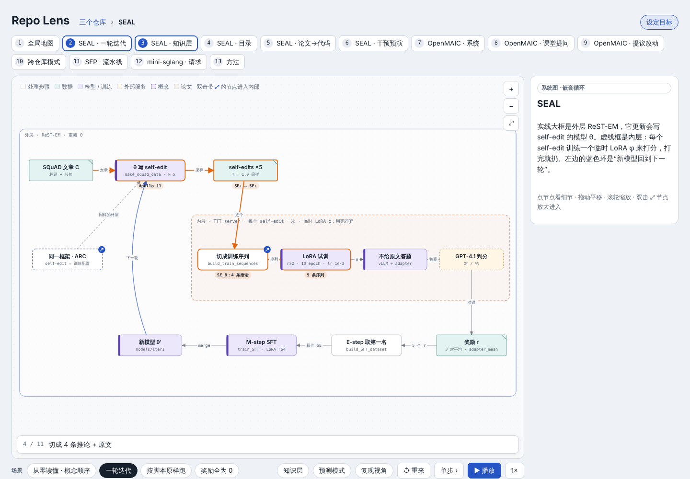
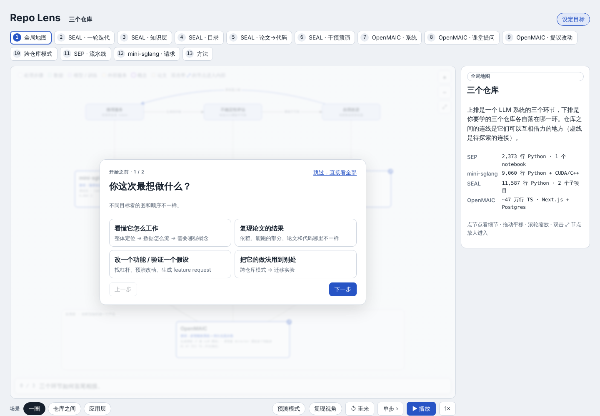
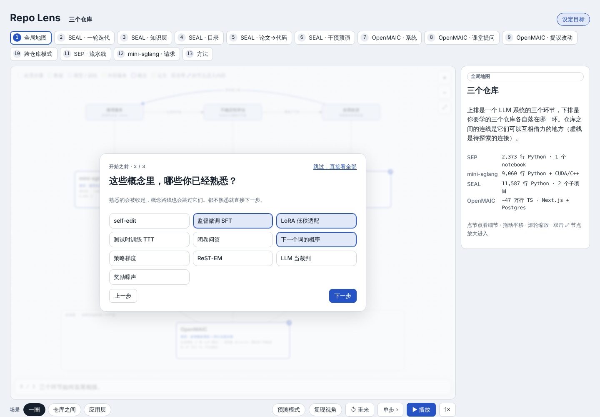
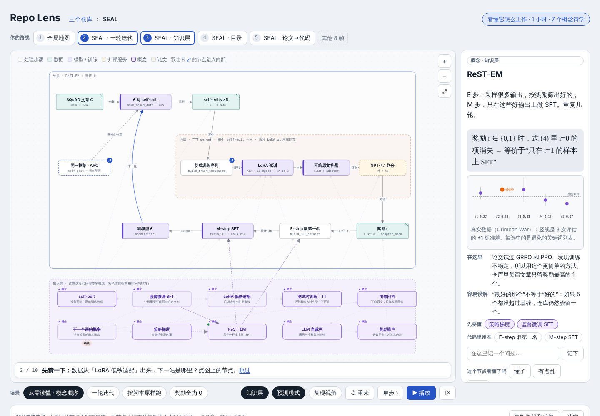
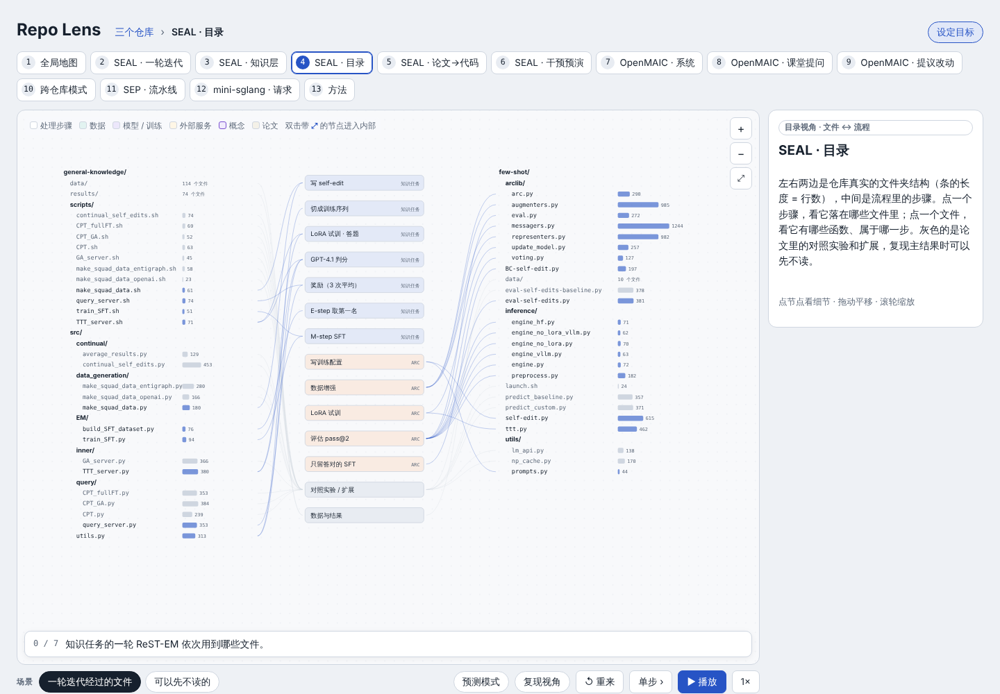
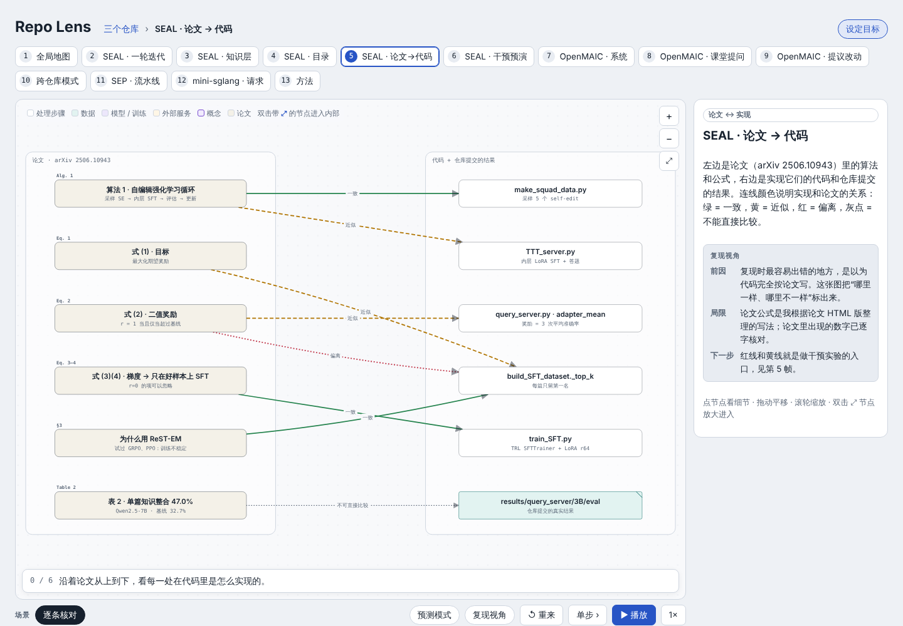
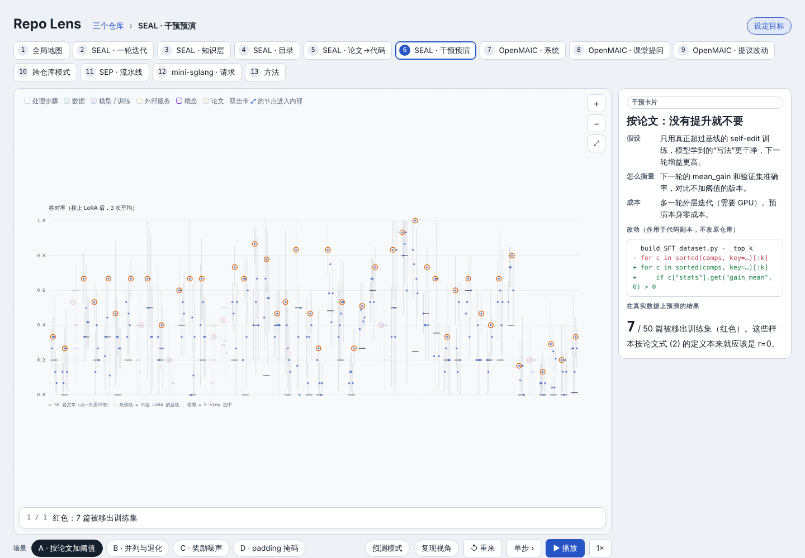
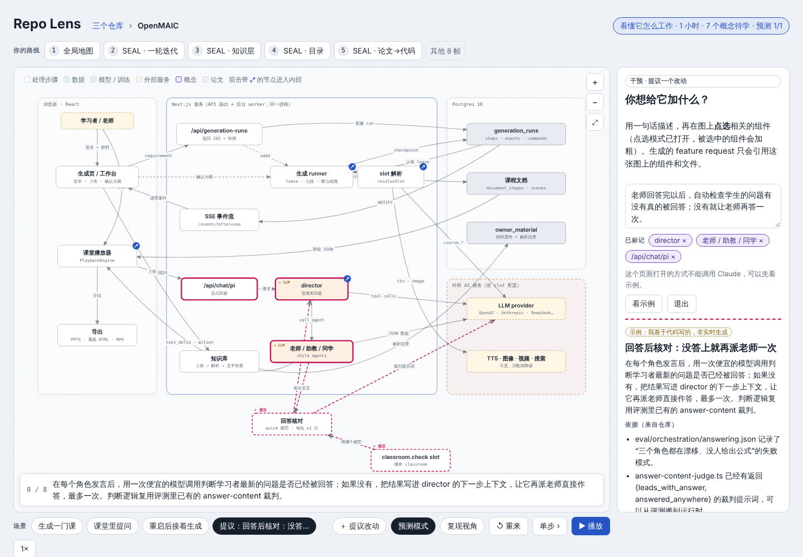
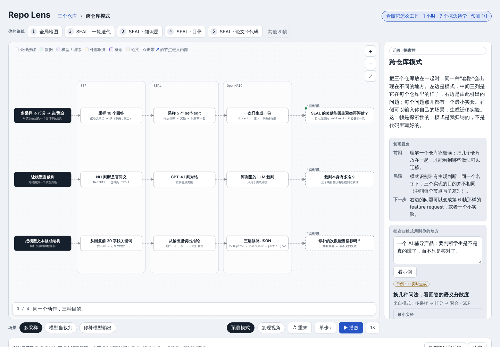
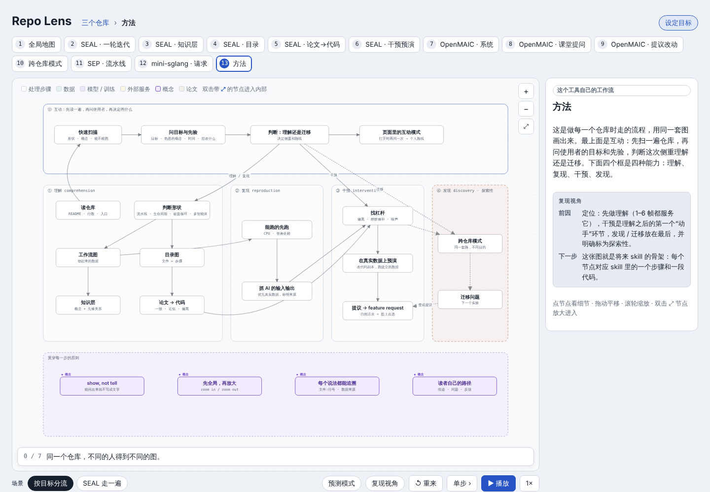

# Code Anatomy

Code Anatomy is an agent skill that turns LLM and research repositories into interactive, animated walkthroughs. Follow workflows and data flow, connect paper concepts to code, and explore possible changes. Source snippets link to pinned commits, and results state where their evidence comes from.



---

## 它解决什么问题

读一个研究仓库，难的不是某一行代码，而是**看不见的过程**：

- **顺序**：先跑什么、后跑什么，内层循环和外层循环怎么嵌套；
- **数据**：每一步进来什么、出去什么，形状和内容怎么变；
- **原因**：这一步实现的是论文里哪个想法，又在哪里和论文不一样。

静态架构图只有框和线，README 只有文字，论文只有公式。Code Anatomy 把三者放在**同一张会动的图**上：节点是代码，连线是数据，场景让一个带标签的数据包按真实顺序走一遍；概念节点也在同一张画布上，用紫色虚线连到用到它的代码。

## 核心特点

### 1. 先问你，再画图（互动模式）

同一个仓库，新手和要做 ablation 的研究者需要的图完全不一样。Code Anatomy 在动手之前先快速扫一遍仓库，然后**用仓库里真实的概念和模块**来提问：

| 问什么 | 会改变什么 |
|---|---|
| 你的目标：看懂 / 复现 / 改功能 / 迁移 | 路线顺序、默认打开的视角 |
| 你的背景 | 概念讲多深、从哪里开始 |
| 这些概念熟悉吗（如 LoRA、ReST-EM） | 熟悉的折叠，概念路线自动跳过 |
| 关心哪个子系统 / 有多少时间 | 画哪些图、路线有几帧 |

第二轮问题**随第一轮的回答变化**：选“改功能”会问想改什么，选“迁移”会问用到哪里，选“复现”会问有没有 GPU。每个问题都必须能改变至少一个构建决定，否则就不问。生成的页面打开时也会问同样的问题，给每个读者排出自己的路线。




### 2. 判断这次侧重“理解”还是“迁移”

Code Anatomy 把学习研究代码分成四种能力，每次请求选一个主侧重、一个次侧重：

| 能力 | 先看什么 | 页面默认 |
|---|---|---|
| **理解** comprehension | 全局 → 数据流 → 知识层 → 目录 → 论文↔代码 | 知识层开、预测模式开 |
| **复现** reproduction | 带“复现视角”的流程 → 哪些能跑、哪些要 GPU → 论文和代码的偏差 | 复现视角开 |
| **干预** intervention | 偏差（红/黄线）→ 在真实数据上预演改动 → 生成 feature request | 提议面板 |
| **迁移** transfer | 跨仓库模式 → 迁移问题 → 两周内能做的最小实验 | 迁移面板 |

### 3. 先全局，再放大：一个仓库，七种视角

| 视角 | 回答的问题 |
|---|---|
| 全局地图 | 它在整个系统里处在哪个位置？和其他仓库什么关系？ |
| 系统 / 工作流 | 什么在跑、按什么顺序、带着什么数据？（可播放多个场景） |
| 节点内部 | 这一步里面到底发生了什么？（聚类过程、radix 树、时间轴…） |
| 知识层 | 需要懂哪些概念？先修关系是什么？用在代码的哪里？ |
| 目录 | 哪个步骤落在哪些文件里？哪些文件可以先不读？ |
| 论文 → 代码 | 代码是不是论文说的那样？一致 / 近似 / 偏离 / 不可比 |
| 干预与迁移 | 改这里会怎样？这个做法能用到哪里？ |



| 目录：文件 ↔ 流程 | 论文 → 代码 |
|---|---|
|  |  |

### 4. 每个说法都能追溯

- **代码片段**由 `build.py` 在构建时按行号从固定 commit 里取出；行号不对、文件不存在，构建直接失败。
- **每一块数据都标明来源**：仓库提交的真实结果 / 本地实跑仓库原代码 / 测试里的 mock / 模板示例 / 合成数据。
- **能跑的先跑**：没有 GPU、没有外网时，挑出纯逻辑的函数，用最小替身补依赖，**实跑仓库自己的代码**。附带 Python 和 TypeScript 两套工具。

### 5. 从“看懂”走到“动手”

- **干预预演**：在仓库提交的真实数据上运行改过的代码副本，直接看到“会有多少样本被改变”，不用先占用 GPU。
- **自然语言提议改动**：写一句想加的功能，在图上点选相关组件，Claude 生成一份**只引用这张图上组件和文件**的 feature request。新组件以虚线画回图上，数据流可以播放；引用的每个文件都会和仓库的真实文件列表核对。
- **迁移实验**：输入你自己的场景，基于跨仓库模式生成三张“两周内可完成”的实验卡片（假设、做法、指标、成本、风险）。

| 在真实数据上预演改动 | 生成 feature request，画回图上 |
|---|---|
|  |  |



### 6. 读者自己的路径

借鉴 *Creative Reading: Scaffolding Reading for Transformation*（Liu et al., HT '26）：工具**搭脚手架，而不是替你读**。读者自己决定往哪里放大；看过的节点留下痕迹；可以在任何节点上记问题；预测对错有记录。整条路径可以导出成 JSON，作为下一轮迭代的反馈。

## 效果：在四个仓库上发现了什么

这些不是事先知道的，而是按这套方法走一遍时，从代码和仓库自带的数据里“看出来”的：

**SEAL**（Self-Adapting Language Models，MIT）
- 论文脚注说知识任务奖励“带来最大提升的那个 self-edit”；代码取了最大值，但**不检查它是否真的超过基线**。用仓库自己的 `_top_k` 跑仓库提交的第 0 轮结果：50 篇里有 **7 篇**的训练样本按论文定义应得 0 分（第 1 轮是 13 篇）。
- 同一个 self-edit 重复评估 3 次的标准差（0.173）**大于**不同 self-edit 之间的标准差（0.129）。按两倍标准误粗略判断，**45/50** 篇的第 1、2 名分不开。
- 并列时排序保留原顺序，于是 Crimean War 这篇选中了**一个退化成重复关键词列表**的 self-edit。
- 仓库提交的结果在 `3B` 文件夹里，论文主实验是 Qwen2.5-7B：两组数字不能直接比较。

**OpenMAIC**（多智能体课堂）
- director 选谁发言完全靠提示词规则，`priority` 字段只被写进提示词，从不参与计算。
- 模型输出经过三层静默修补（parse → jsonrepair → partial-json），再按场景和角色白名单过滤，修补率没有被统计。
- 仓库没有提交任何真实模型输出，评测结果目录被 gitignore：要看真实输入输出必须自己配 key 跑评测。

**Semantic Entropy Probes / mini-sglang**
- 用仓库原函数实跑：同一个答案换 4 种写法，常规熵 0.76，语义熵为 0。
- mini-sglang 自己的 radix 缓存处理 4 个请求：第二个请求共享前缀 7 个 token、只新算 2 个；驱逐按最久未用的叶子删除。

## 预期影响

- **对学习者**：从“读完 README 还是不知道从哪下手”，到 15 分钟内能说出“这个仓库长什么样、数据怎么流、知识任务该先读哪 10 个文件”。预测模式和概念路线把被动浏览变成主动检索。
- **对复现者**：在占用 GPU 之前就知道哪些地方代码和论文不一样、哪些数字不可比、改动会影响多少样本。
- **对研究者和产品人**：把“看懂别人做了什么”接到“我能改什么、能借什么”，并且每一步都落在可验证的文件、行号和数据上。

这些是设计目标，还没有做用户研究。页面导出的路径、预测正确率和“看懂了吗”可以直接作为评估数据。

## 快速开始

```bash
git clone https://github.com/ywEdAi/code-anatomy.git
cd code-anatomy
```

Load `SKILL.md` in your agent. Open `examples/four-repos/index.html` or `examples/starter-sep/index.html` directly in a browser to explore the included walkthroughs.

Building pages requires Python 3 and Node.js. To rebuild an example, clone the source repositories at the commits linked in its `repos.json`, then set each `root` to your local clone path. Browser verification requires Python Playwright and Chromium.

在 Claude 里说：

> 用 code-anatomy 帮我看懂 https://github.com/Continual-Intelligence/SEAL

Claude 会先扫一遍仓库，用两三个问题确认你的目标和背景，告诉你它选择的侧重，然后先给你 3–5 个关键帧，你看过再决定往哪里深入。

手动构建一个页面：

```bash
python3 -I scripts/inventory.py /work/SEAL --out seal.inv.json --summary      # 形状信号、入口、行数
python3 scripts/build.py examples/four-repos --out out/index.html             # 校验行号和 id，生成单个 HTML
python3 -I scripts/check.py out/index.html --shots out/shots                  # 播放所有场景，截图所有关键帧
```

## 文件夹结构

```
code-anatomy/
├── SKILL.md                    给 Claude 的流程：扫描 → 互动提问 → 判断侧重 → 跑代码 → 画图 → 校验 → 交付
├── README.md
├── references/
│   ├── interview.md            互动模式：问题库、换问题的规则、侧重判断、回答如何改变构建
│   ├── method.md               四种能力、仓库形状、七种视角、原则
│   ├── graph-spec.md           图的写法（节点、连线、场景、自定义视图、页面配置）
│   ├── concepts.md             知识层：选哪些概念、写什么、按背景调深度
│   ├── paper-to-code.md        论文↔代码的四种状态和证据
│   ├── interventions.md        找杠杆、干预卡片、真实数据预演、feature request
│   ├── transfer.md             跨仓库模式、迁移问题 → 最小实验
│   └── running-code.md         没有 GPU / 外网时怎样实跑仓库原代码，来源标签
├── assets/                     页面引擎（画布、缩放、场景、互动模式、预测、提议、迁移）
│   └── views/directory.js      可复用的“目录 ↔ 流程”视图
├── scripts/
│   ├── inventory.py            文件清单、函数定义、形状信号
│   ├── build.py                校验 + 注入源码行 + 生成单个 HTML
│   ├── check.py                无头浏览器播放全部场景、截图、暗色和手机宽度检查
│   ├── pyrun.py                在 CPU 上调用 Python 仓库的函数（替身依赖）
│   └── ts_loader/              在 Node 里直接运行 TypeScript 仓库的模块
├── examples/
│   ├── four-repos/             完整示例：SEP、mini-sglang、SEAL、OpenMAIC（24 张图、13 个关键帧、实跑脚本）
│   └── starter-sep/            最小示例：不写坐标，全部自动排版
└── docs/img/                   截图
```



## 局限

- **画图仍需判断**：形状识别、概念挑选、跨仓库模式都含有作者的判断。页面会标出“探索性”和“替身”，但不会替你确认这些判断是对的。
- **自动布局适合中小图**：复杂的系统图仍建议手写坐标。
- **实时生成依赖授权**：feature request 和迁移实验需要读者允许页面调用 Claude（消耗读者自己的用量）；不允许时显示作者写好的示例。
- **没有 GPU 时只能预演一部分**：需要训练的改动只给出改动和衡量方法，不给结果。
- **还没有做用户研究**：上面的“预期影响”需要用导出的学习路径和预测数据来验证。

## 致谢

方法受 *Creative Reading: Scaffolding Reading for Transformation*（Liu, Abowitz, Liu, Sterman, Almeda, Kreminski, HT '26）启发。示例仓库：[semantic-entropy-probes](https://github.com/OATML/semantic-entropy-probes)、[mini-sglang](https://github.com/sgl-project/mini-sglang)、[SEAL](https://github.com/Continual-Intelligence/SEAL)、[OpenMAIC](https://github.com/THU-MAIC/OpenMAIC)。
