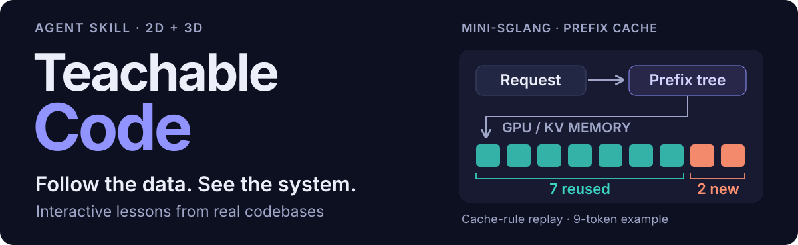
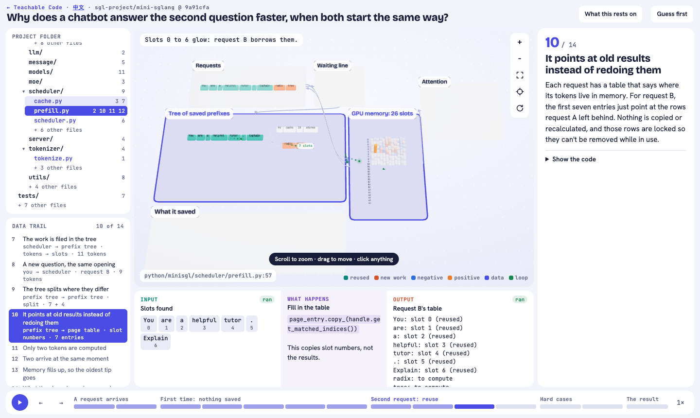
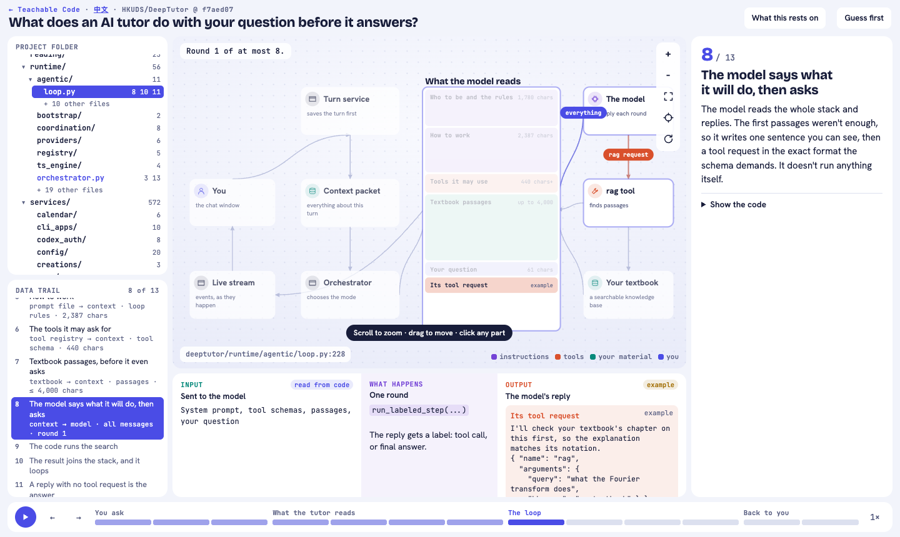

<p align="center">
  
</p>

<p align="center"><strong>English</strong> · <a href="README.zh-CN.md">简体中文</a></p>
<p align="center"><a href="https://ywedai.github.io/teachable-code/"><strong>Open live demo ↗</strong></a> · <a href="https://ywedai.github.io/teachable-code/zh-CN/">中文演示 ↗</a> · <a href="#teach-me-a-repository">Use the skill</a></p>

**Teachable Code** is an agent skill that turns a codebase into an interactive lesson. Explore a persistent system map, follow the current step, and inspect the source files and data behind it. Use **3D for tensors and memory**, **2D for applications and tool calls**.

[](https://ywedai.github.io/teachable-code/lessons/mini-sglang.html)

*mini-SGLang example: reuse 7 tokens, compute 2 new ones. The system map, source files, current step and input/output stay visible together.*

[Explore the five examples](#five-worked-examples) · [Run the demo](#open-the-demo-in-your-browser) · [Use the skill](#teach-me-a-repository) · [中文示例](https://ywedai.github.io/teachable-code/zh-CN/)

## Five worked examples

Choose a question and open the lesson. Every demo runs in your browser, in English or Chinese.

| Repository | Follow the process | View | Open lesson |
| --- | --- | --- | --- |
| **mini-SGLang** | Request → prefix tree → KV memory → attention. Why does the next request need less work? | 3D · 14 steps | [EN](https://ywedai.github.io/teachable-code/lessons/mini-sglang.html) · [中文](https://ywedai.github.io/teachable-code/zh-CN/lessons/mini-sglang.html) |
| **nanoGPT** | Characters → vectors → attention → sampling → gradients → updated weights. | 3D · 15 steps | [EN](https://ywedai.github.io/teachable-code/lessons/nanogpt.html) · [中文](https://ywedai.github.io/teachable-code/zh-CN/lessons/nanogpt.html) |
| **SWE-agent** | Issue → context → command → sandbox → feedback → patch. | 3D · 13 steps | [EN](https://ywedai.github.io/teachable-code/lessons/swe-agent.html) · [中文](https://ywedai.github.io/teachable-code/zh-CN/lessons/swe-agent.html) |
| **DeepTutor** | Question → instructions → textbook retrieval → tool loop → answer. | 2D · 13 steps | [EN](https://ywedai.github.io/teachable-code/lessons/deeptutor.html) · [中文](https://ywedai.github.io/teachable-code/zh-CN/lessons/deeptutor.html) |
| **AI chatbot** | Send → request checks → context → weather tool → streamed answer. | 2D · 11 steps | [EN](https://ywedai.github.io/teachable-code/lessons/ai-chatbot.html) · [中文](https://ywedai.github.io/teachable-code/zh-CN/lessons/ai-chatbot.html) |

<details>
<summary>See the 2D view in DeepTutor</summary>



</details>

## Open the demo in your browser

Open the **[English gallery](https://ywedai.github.io/teachable-code/)** or **[Chinese gallery](https://ywedai.github.io/teachable-code/zh-CN/)**. No installation, model key or training GPU is needed. Language switching keeps your current step.

<details>
<summary>Run the same demo locally</summary>

```bash
git clone https://github.com/ywEdAi/teachable-code.git
cd teachable-code
python3 -m http.server 8000 --directory docs
```

Open [localhost:8000](http://localhost:8000/) or [localhost:8000/zh-CN/](http://localhost:8000/zh-CN/).

</details>

Fonts and the 3D runtime load from public CDNs. Both the online and local demos need internet access.

## Teach me a repository

Give your coding agent [SKILL.md](SKILL.md), a repository URL, and a question you want to answer. For example:

> Use teachable-code to help me understand mini-sglang. Follow two requests with the same opening through the scheduler and KV cache. Keep the whole system visible, show the input and output at each step, and link each component to its source files. Explain it for someone learning LLM serving.

The agent scans the repository, asks questions that affect the lesson, pins a source commit, and builds a page around your goal. Python 3 and Node.js are needed to build lessons. GPU access, keys or extra dependencies depend on the code you choose to execute.

## What you can explore

- **The whole system stays visible.** The active components light up while their relationships remain on the canvas.
- **Compare input and output.** Values, prompts, tool arguments and results sit beside the operation that connects them.
- **Move between behavior and source.** Click a component or a project file to see where it belongs and which steps use it.
- **Understand iteration.** Replay decoding, training updates and agent tool loops. Use “Guess first” to predict selected steps.
- **Follow the evidence.** Code references point to pinned commits. Lessons explain whether values come from source reading, a replay, a simulation or execution.

## Be clear about the evidence

The five lessons demonstrate the teaching format. **They do not reproduce the upstream projects' published results.**

| Example | What the lesson uses |
| --- | --- |
| nanoGPT | Our own small CPU model following the source structure. The upstream code was not run. |
| mini-SGLang | Our own replay of cache rules with illustrative requests. Token counts are not a speed benchmark. |
| SWE-agent | Text from a recorded demonstration committed upstream. No live model was called. |
| DeepTutor and AI chatbot | Prompt text and tool schemas read from source. Conversations and tool results are illustrative. |

Chinese pages translate the interface and explanations. Source code, original prompts and numerical values remain unchanged for comparison. Browser checks verify interaction and layout; learning outcomes have not been evaluated with learners.

## Build and extend

- [Lesson authoring and schema](references/lessons.md)
- [Choose a learner's route](references/interview.md)
- [Paper-to-code evidence](references/paper-to-code.md)
- [Running code and labeling its provenance](references/running-code.md)
- [Earlier multi-repository graph example](examples/four-repos/README.md)

Rebuild the bilingual demo site from the checked-in standalone lessons:

```bash
python3 scripts/build_site.py
python3 -m unittest discover -s scripts -p test_build_site.py
```

To build a lesson against a clean clone at its pinned commit:

```bash
python3 scripts/build_lesson.py examples/lessons/mini-sglang \
  --repo /path/to/mini-sglang --standalone \
  --out examples/lessons/mini-sglang/standalone.html
python3 scripts/build_site.py
```

Browser verification uses Python Playwright and Chrome or Chromium:

```bash
python3 scripts/check_lesson.py docs/lessons/mini-sglang.html
python3 scripts/check_lesson.py docs/zh-CN/lessons/mini-sglang.html
```

Chinese text lives in each lesson's `zh-CN.json`. The site build refuses a translation when the pinned commit or ordered source step titles change.

## Source projects

The worked examples study [mini-sglang](https://github.com/sgl-project/mini-sglang), [nanoGPT](https://github.com/karpathy/nanoGPT), [SWE-agent](https://github.com/SWE-agent/SWE-agent), [DeepTutor](https://github.com/HKUDS/DeepTutor), and [AI chatbot](https://github.com/vercel/ai-chatbot). Source excerpts and recorded material belong to their respective projects. See each lesson for pinned commits and specific limitations.
