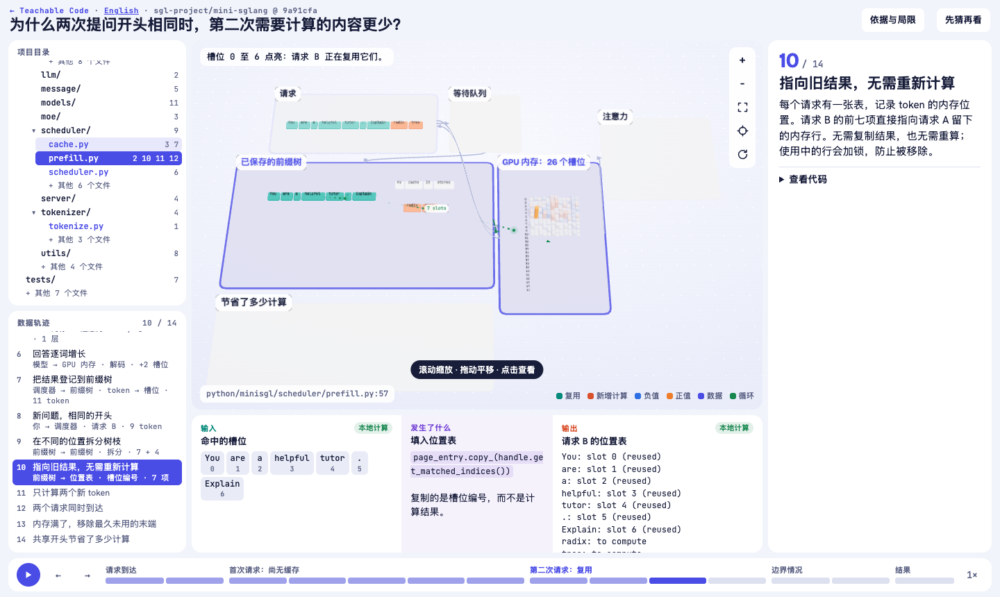
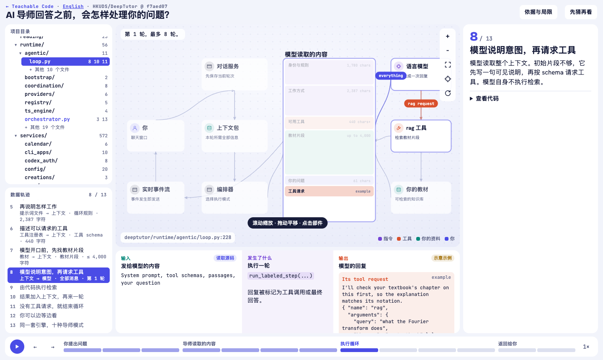

# Teachable Code

[English](README.md) · **简体中文**

### 跟着一份数据，看懂代码如何运转。

一个把代码仓库变成交互课程的 agent skill。在完整系统图中跟随当前步骤，点击查看背后的源文件与数据。**用 3D 表达张量和内存，用 2D 表达应用与工具调用。**



*系统全貌、当前步骤、项目目录与数据同屏呈现。缩放、拖动，点击部件即可查看详情。*

[查看五个示例](#五个完整示例) · [在浏览器运行](#在浏览器打开示例) · [使用这个 skill](#让-agent-带你读一个仓库) · [英文示例](docs/index.html)

## 五个完整示例

每节课从一个具体问题出发，均提供英文和中文版本。下方链接指向静态 HTML 文件；用本地服务打开 `docs/` 后即可交互。

| 仓库 | 跟随什么过程 | 视图 | 课程文件 |
| --- | --- | --- | --- |
| **mini-SGLang** | 请求 → 前缀树 → KV 内存 → 注意力。为什么第二次请求可以少算一些？ | 3D · 14 步 | [中文](docs/zh-CN/lessons/mini-sglang.html) · [EN](docs/lessons/mini-sglang.html) |
| **nanoGPT** | 字符 → 向量 → 注意力 → 采样 → 梯度 → 权重更新。 | 3D · 15 步 | [中文](docs/zh-CN/lessons/nanogpt.html) · [EN](docs/lessons/nanogpt.html) |
| **SWE-agent** | 问题 → 上下文 → 命令 → 沙箱 → 反馈 → 补丁。 | 3D · 13 步 | [中文](docs/zh-CN/lessons/swe-agent.html) · [EN](docs/lessons/swe-agent.html) |
| **DeepTutor** | 提问 → 指令 → 教材检索 → 工具循环 → 回答。 | 2D · 13 步 | [中文](docs/zh-CN/lessons/deeptutor.html) · [EN](docs/lessons/deeptutor.html) |
| **AI chatbot** | 发送 → 请求检查 → 上下文 → 天气工具 → 流式回答。 | 2D · 11 步 | [中文](docs/zh-CN/lessons/ai-chatbot.html) · [EN](docs/lessons/ai-chatbot.html) |

<details>
<summary>看看 DeepTutor 的 2D 视图</summary>



</details>

## 在浏览器打开示例

浏览已有课程不需要模型密钥或 GPU。

```bash
git clone https://github.com/ywEdAi/teachable-code.git
cd teachable-code
python3 -m http.server 8000 --directory docs
```

打开[中文画廊](http://localhost:8000/zh-CN/)或[英文画廊](http://localhost:8000/)。课程内切换语言会保留当前步骤。字体和 3D 运行库来自公共 CDN，因此需要网络连接。

仓库已经包含适合 GitHub Pages 的静态站点。以上命令用于本地浏览，线上 Pages 部署需要另外启用。

## 让 agent 带你读一个仓库

把 [SKILL.md](SKILL.md)、仓库链接和你想回答的问题交给编程 agent。例如：

> 用 teachable-code 帮我理解 mini-sglang。跟随两个开头相同的请求，看看它们如何经过调度器和 KV 缓存。完整系统始终留在画布上，每一步展示输入输出，并把组件连接到对应源码。请按正在学习 LLM 推理服务的读者来解释。

Agent 会先扫描仓库，询问能影响课程设计的问题，固定源码提交，再围绕你的目标构建页面。构建课程需要 Python 3 和 Node.js；是否需要 GPU、密钥或其他依赖，取决于你选择实际运行的代码。

## 可以怎样探索

- **始终看见整体。** 当前组件随步骤点亮，其他组件与连接保持在画布上。
- **对照输入与输出。** 把数值、提示词、工具参数与结果，放在对应处理过程旁边。
- **从过程回到源码。** 点击组件或项目文件，查看它在系统中的位置，以及使用它的步骤。
- **看懂迭代。** 回放解码、训练更新和工具调用循环；部分步骤可开启“先猜再看”。
- **追踪证据。** 代码引用固定到具体提交，每节课说明数值来自源码阅读、回放、自写模拟还是实际执行。

## 先说明证据来自哪里

这五节课用于展示教学形式，**并未复现上游项目发布的实验成绩。**

| 示例 | 使用了什么证据 |
| --- | --- |
| nanoGPT | 参照源码结构自写并在 CPU 上运行的小模型，未运行上游原代码。 |
| mini-SGLang | 按缓存规则自写的回放与示例请求。Token 计算量不代表速度基准。 |
| SWE-agent | 上游仓库提交的示范回放文本，没有实时调用模型。 |
| DeepTutor 与 AI chatbot | 从源码读取的提示词与工具 schema；对话和工具结果为示意示例。 |

中文版翻译界面与讲解，保留原始代码、提示词和数值，便于对照。浏览器检查验证交互与布局，尚未通过学习者研究评估教学效果。

## 构建与扩展

- [课程编写方法与数据格式](references/lessons.md)
- [根据读者选择学习路线](references/interview.md)
- [论文与代码的证据对照](references/paper-to-code.md)
- [运行代码与标注来源](references/running-code.md)
- [早期多仓库图示例](examples/four-repos/README.md)

用已提交的 standalone 课程重新生成中英文站点：

```bash
python3 scripts/build_site.py
python3 -m unittest discover -s scripts -p test_build_site.py
```

用干净、处于指定提交的上游克隆构建课程：

```bash
python3 scripts/build_lesson.py examples/lessons/mini-sglang \
  --repo /path/to/mini-sglang --standalone \
  --out examples/lessons/mini-sglang/standalone.html
python3 scripts/build_site.py
```

浏览器检查需要 Python Playwright，以及 Chrome 或 Chromium：

```bash
python3 scripts/check_lesson.py docs/lessons/mini-sglang.html
python3 scripts/check_lesson.py docs/zh-CN/lessons/mini-sglang.html
```

中文文本保存在各课程的 `zh-CN.json`。如果上游固定提交或英文步骤标题及其顺序发生变化，站点构建会拒绝使用旧翻译。

## 示例来源

课程研究了 [mini-sglang](https://github.com/sgl-project/mini-sglang)、[nanoGPT](https://github.com/karpathy/nanoGPT)、[SWE-agent](https://github.com/SWE-agent/SWE-agent)、[DeepTutor](https://github.com/HKUDS/DeepTutor) 和 [AI chatbot](https://github.com/vercel/ai-chatbot)。源码片段与回放材料属于各自项目。具体提交与限制见课程内说明。
